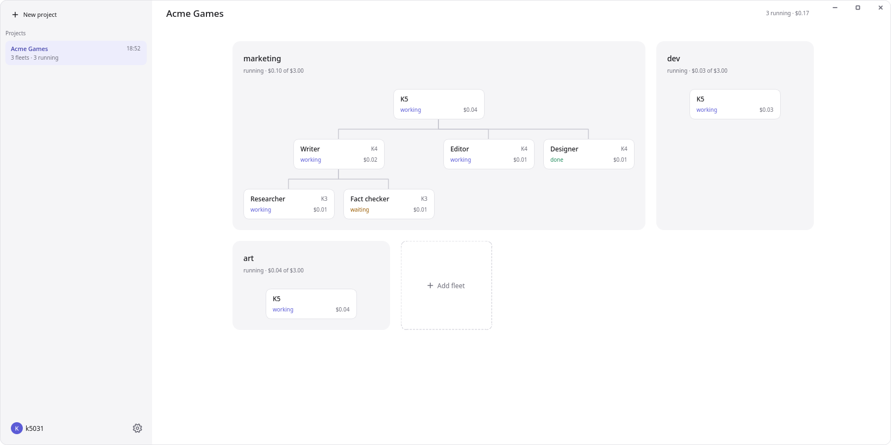

# KFM

Kadence Fleet Manager runs a team of [Kadence](https://github.com/K5031/Kadence) agents on one
task. You tell the lead agent what you want; it plans, hands parts of the work to agents
below it, checks what comes back and reports to you. The fleet works without supervision,
inside the spending limit and permissions you set.

<picture>
  <source media="(prefers-color-scheme: dark)" srcset="docs/images/window-dark.png">
  
</picture>

A project's fleets in the window.

It is an early version.

```bash
kfm run "Audit this repository's docs and fix what is out of date" --budget 5
```

See [the documentation](docs/README.md) to install and use it, and
[PHILOSOPHY.md](PHILOSOPHY.md) for where it is going.
