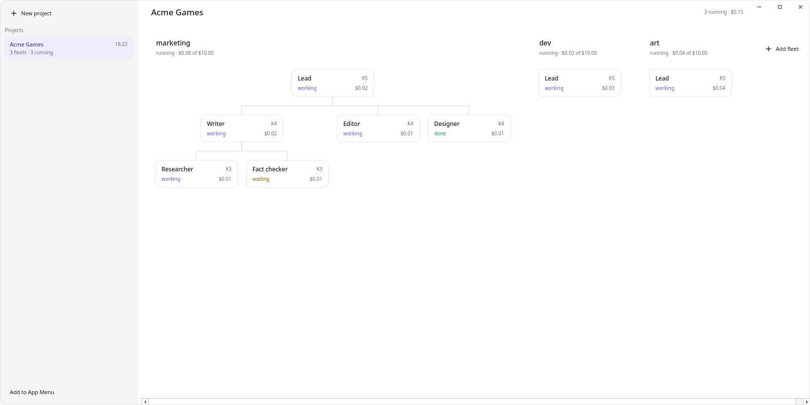
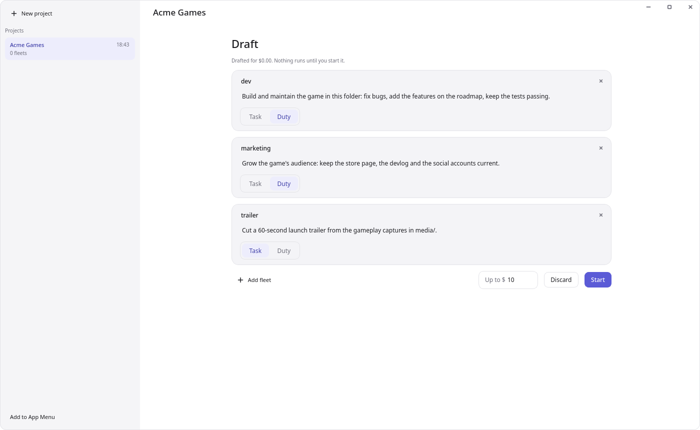
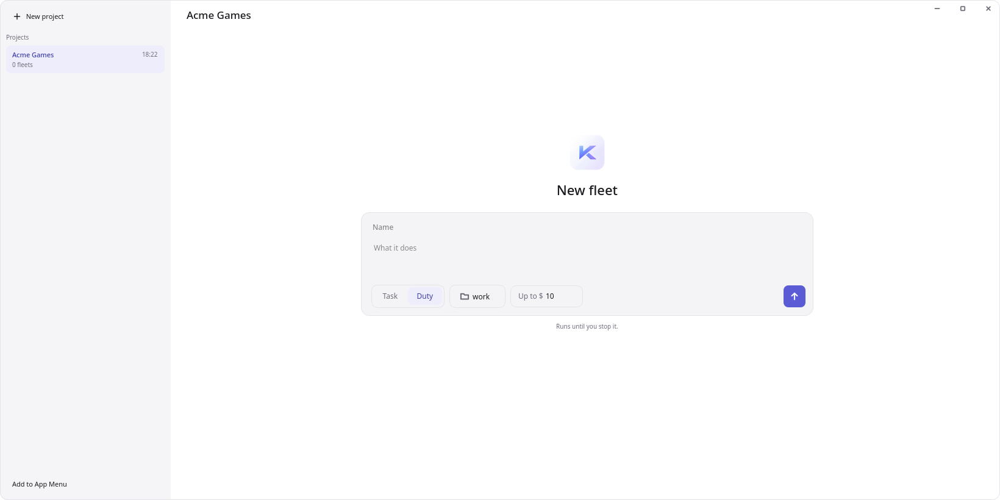
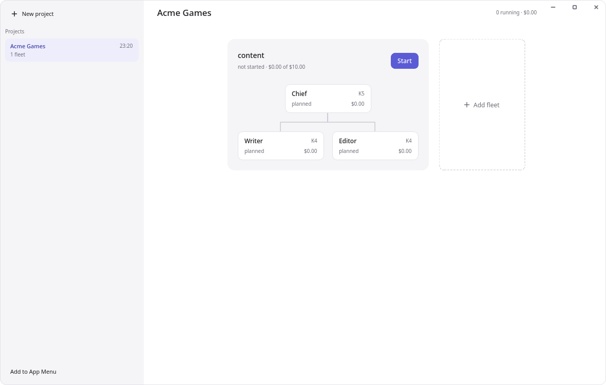
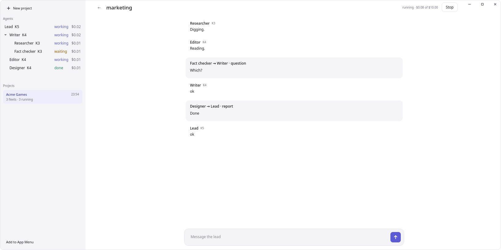

# KFM documentation

KFM (Kayden Fleet Manager) runs a team of Kayden agents on one task. You talk to the lead
agent; it hands work to agents below it and reports back.

## Install

KFM needs [Kayden](https://github.com/K5031/Kayden) checked out next to it (`../Kayden`)
and set up with a provider and an API key, and [uv](https://docs.astral.sh/uv/).

```bash
uv tool install --editable .
```

Without installing, `uv run kfm` works from the checkout.

## Run a fleet

In the folder the agents should work in:

```bash
kfm run "Audit the docs in this repository and fix what is out of date" --budget 5
```

| Option | Does |
|---|---|
| `--budget 5` | The most the whole fleet may spend, in US dollars (default 10) |
| `--unit-budget 1` | The most one agent may spend (default 2) |
| `--top-rank 3` | The lead's rank. 5 (the default) allows four levels below the lead; 1 means the lead works alone |
| `--duty` | Standing work that never ends ("be the support team") instead of a task that finishes |
| `--work PATH` | The folder the agents work in (default: the current one) |
| `--fleet PATH` | Where the fleet keeps its files (default: a new folder in `~/.kfm/fleets/`). A folder that already holds a fleet is refused: use `kfm resume --fleet` for that |

While it runs, the terminal shows what happens:

```
[K5 u1] working
[Researcher K4 u2] working
[Researcher K4 u2 → K5 u1] report: Three pages are out of date: ...
[K5 u1 → you] report: Fixed the three pages; details in CHANGES.md.
```

- **Type a message** and press Enter to tell the lead something.
- **Approvals:** agents work freely inside the work folder. When one wants to do something
  outside it, KFM asks you: answer `y` or `n`.
- **Questions:** when the lead needs a decision only you can make, it asks and waits for
  your message. Agents below ask their supervisor, not you.
- **Ctrl+C** stops every agent. A task that finishes ends the run by itself.

```bash
kfm status
```

shows the newest fleet: whether it is running, its agents, what each did and what it
spent.

## Stop a fleet and start it again

A fleet that was stopped (Ctrl+C, a closed terminal, a reboot, or its spending limit)
carries on where it was:

```bash
kfm resume
```

starts the newest fleet again; `--fleet PATH` names another. Every agent that was at work
gets its conversation, plan and role back, is told that the fleet was down, and looks at
what changed meanwhile. Agents that had finished stay finished.

- **More money:** a fleet that stopped at its limit needs a higher one:
  `kfm resume --budget 20`. `--unit-budget` applies to agents started from then on.
- **What is lost:** commands that were running when the fleet stopped, and a question an
  agent had asked without getting an answer; it asks again.

## The window

```bash
kfm-desktop
```



opens a window that does what `kfm run`, `kfm status` and `kfm resume` do, without a
terminal. It needs the `desktop` extra: `uv tool install --editable ".[desktop]"`.

- **A project** is an organisation of fleets: a company, with a fleet for each team
  ("marketing", "dev"). Make one with **New project**: give it a name and choose the
  folder its fleets work in. None is suggested, and your home folder itself is refused,
  since agents work freely inside the folder they are given. Projects are listed on the
  left; click one to switch to it. Right-click one to **delete** it: its fleets are
  stopped and their records and logs removed, after you confirm. The folder the agents
  worked in, and everything in it, is kept.
- **Describe the project** in the box under its name to have its fleets drafted: one
  agent reads what you want and proposes the teams, each with a name and what it is
  there to do. You can rename them, rewrite what they do, leave some out or add your
  own. Nothing runs until you press **Start**, which starts them all, each with the
  limit shown beside it. Leave the box empty to add the fleets yourself: the project
  opens on its chart, empty, with **Add fleet**.

  

- **The chart** is a project's main screen: its fleets side by side, each as the tree of
  who supervises whom, the K5 lead on top. Each agent shows its rank, its state and what
  it has spent. How large a fleet is, is what you see here: its lead hires as the work
  needs.
- **Add fleet**, after the last fleet on the chart: give it a name, write what it does and
  press Enter. A lead starts on that and hires the agents it needs. Under the text you choose **Duty** (standing work that never ends) or
  **Task** (ends when the lead reports it done), a folder of its own if it should not
  work in the project's, and the most the fleet may spend.

  

- **Build a fleet yourself** by leaving "what it does" empty. The fleet appears on the
  chart with no agents and runs nothing. **Add agent** makes its lead; a name, a task
  and a model of its own are all optional. Agents have no name unless given one: a nameless
  agent is shown by its rank ("K4"), and by rank and number ("K4 u2") where agents have
  to be told apart. A lead may name the agents it hires by their role. An agent with no task does not start: it
  takes the first message it gets as its task (its supervisor's, or yours for the lead),
  so you can set up who is on the team and leave the work to be handed out. Right-click an agent to add agents under it.
  **Start**, beside the fleet's name, starts them all, each on the task you gave it; a
  supervisor is told which agents you put under it.

  

- **Right-click an agent** on the chart of any fleet to shape its team. **Add agent**
  puts a new agent under it; its supervisor is told. **Model** changes the model the
  agent runs on, by the model's id; leave it empty for the one its rank has in the
  settings. In a running fleet both happen at once (an agent starts again on its new
  model); in a stopped one they take effect when you start it.
- **Task…** in an agent's right-click menu gives it another task. It keeps its
  conversation, is told, and its supervisor is told. In a stopped fleet this works for
  agents that have not run yet.
- **Remove…** takes an agent out of the fleet, with every agent under it: they stop,
  and what they kept is deleted. Its supervisor is told, so the work can be picked up.
- **Rename** an agent, a fleet or a project by right-clicking it and choosing
  **Rename…**. Agents are not told: they know each other by number, and a renamed
  agent's reports carry its new name from then on.
- **Delete a fleet** by right-clicking its name on the chart. It is stopped and its
  record and log are removed, after you confirm; the folder it worked in is kept.
- **Several fleets run at once.** Each has its own limit, and is stopped and resumed by
  itself. Fleets do not talk to each other: each lead reports to you.
- **Open a fleet** by clicking its name on the chart, or an agent to see only what
  concerns it. The arrow at the top left leads back to the chart.

  

- **Agents** of the open fleet are on the left, each under its supervisor, with its
  state and what it has spent. Click one to see only what concerns it; **Show all**
  brings everything back.
- **The timeline** shows what the lead says and every report, question and update in
  full, with who sent it to whom. An approval is a card with **Allow** and **Deny**.
- **Message the lead** in the box at the bottom; Enter sends, Shift+Enter starts a new
  line. A message to a stopped fleet starts it again.
- **An agent's page is a conversation with it.** Choose an agent in the agents list (or
  click it on the chart) to see its task, what its supervisor told it, what it wrote and
  what its own agents sent it, in order. Unlike a chat, others speak in it too, it works
  whether you write or not, and its reports go to its supervisor. With no agent chosen
  the page is the whole fleet's feed.
- **Attach files** to a message with the plus beside the box, by dropping them anywhere
  on the fleet's page, or by pasting them; a copied picture is pasted as a file. They go to the agent the message is for, which reads what it can (pictures, PDFs,
  text and office files); files alone are a message too.
- **Message one agent** by choosing it in the agents list first: the box then says whom
  it goes to. The agent is told the message is yours and that it stands over what its
  supervisor said; its supervisor is told what you said. With no agent chosen, or the
  lead chosen, the message goes to the lead.
- **The window has no title bar.** Drag it by the bar at the top, double-click that bar
  to maximize, and resize it at its edges; minimize, maximize and close are at the top
  right.
- **Stop** ends the open fleet's processes; **Resume** carries it on. Closing the window
  stops every fleet: none runs in the background.
- **Your name, at the bottom left**, opens the app's menu: Settings, Quit and, on Linux
  until it is done, **Add to App Menu**, which puts KFM in your app menu with its own
  icon so it starts without a terminal.
- **The gear** beside it opens **Settings**: the model of each rank, what a fleet and an
  agent may spend, and how many agents a fleet may have. They apply to fleets made
  afterwards; a fleet keeps what it was made with.

What happens in a fleet is also kept as `log.jsonl` in the fleet's folder, one line per
event, whichever way the fleet was run.

## How a fleet works

- **Ranks.** The lead has the top rank (K5 by default). An agent can hand work only to
  new agents one rank below it, so K1 agents do their work themselves. The fleet uses only
  as many levels as the lead and its agents decide the work needs.
- **Each agent is a separate Kayden** with its own conversation and memory. It sees
  nothing of the others; it knows only its task and what is reported to it.
- **Reports go up.** When an agent finishes, asks a question or fails, its supervisor gets
  a message and decides what to do next: answer, give the task again, or hand it to
  another agent.
- **Spending.** Each agent has its own limit, and the fleet has one for everyone. When the
  fleet's limit is reached, every agent is stopped.

## Settings

`~/.kfm/fleet.toml`, all optional. The window's Settings write the models and the limits
into it and leave the rest as it is:

```toml
top_rank = 5
max_units = 12            # agents in one fleet
budget_usd = 10.0         # the whole fleet
unit_budget_usd = 2.0     # one agent
permissions = "allow_workspace"

[harness_options]         # for Kayden, the agent program the units run
config = "~/.kayden/config.toml"   # the provider, key and options every agent uses

[models]                  # a model per rank; "default" for the rest
K5 = "claude-opus-5-5"
default = "claude-sonnet-5-5"

[teams]                   # a team's model wins over its rank's
marketing = "claude-sonnet-5-5"
```

Without `[models]`, every agent uses the model in your Kayden configuration.

## Another agent program

Every agent of a fleet is a Kayden unless the settings name another program:

```toml
harness = "my_package.my_harness:factory"   # or the name it is installed under

[harness_options]
# whatever that program needs
```

Such a program has to be written for KFM: it works by itself on an instruction, reports,
asks its supervisor when blocked, and uses the fleet's tools. What exactly it must do is
in `src/kfm/api.py`, and `tests/fakeharness.py` is a small complete example.

## Not there yet

- Fleets run only while the window or `kfm run` does.
- A fleet started with `kfm run` belongs to no project and is not shown in the window.
- Fleets of a project do not talk to each other.
- Agents share one folder, and nothing stops two from editing the same file.
