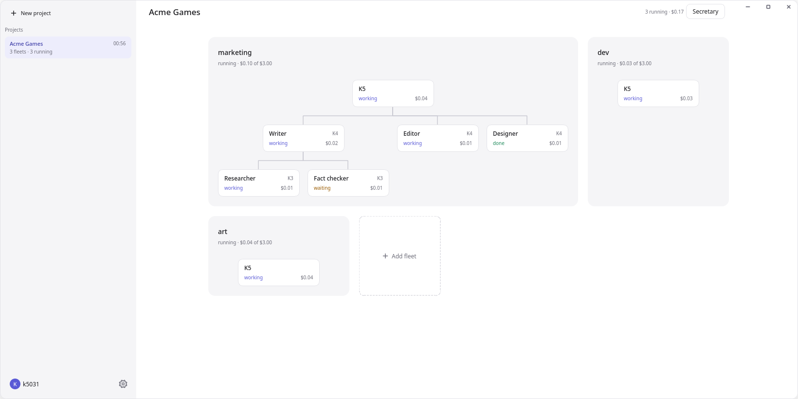
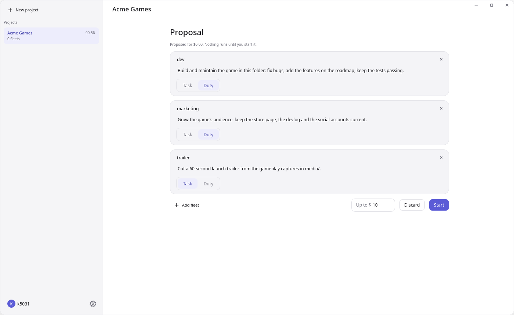
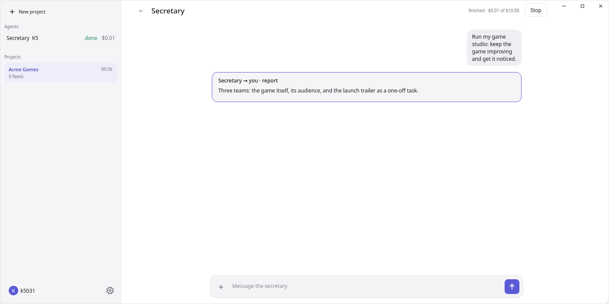
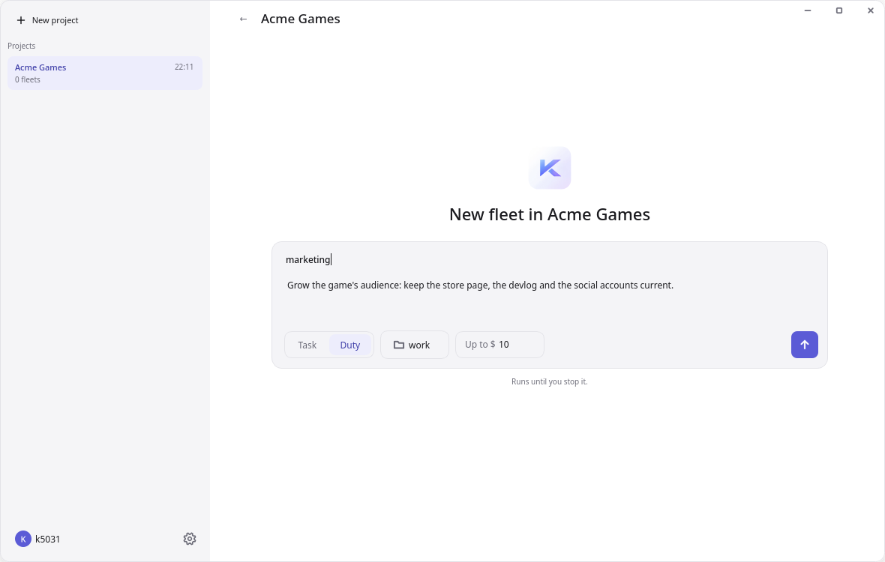
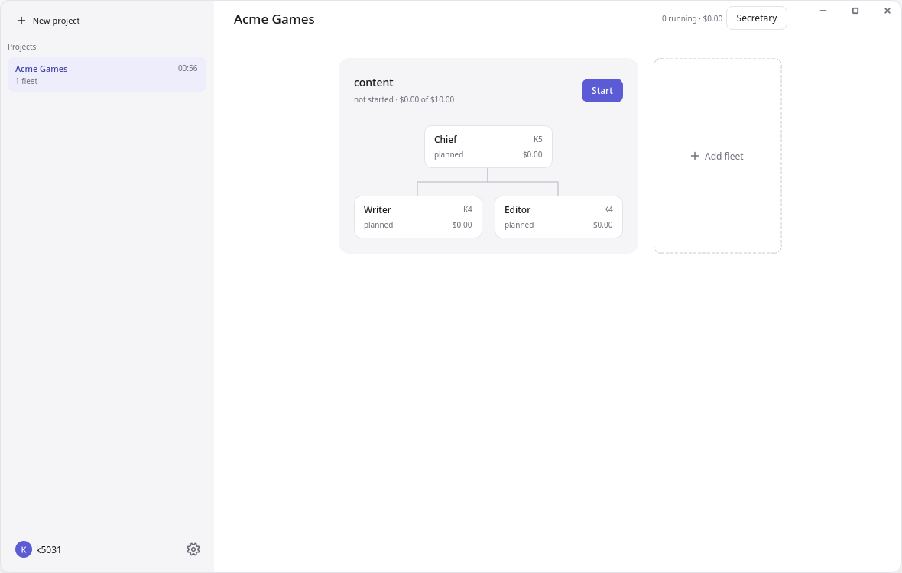
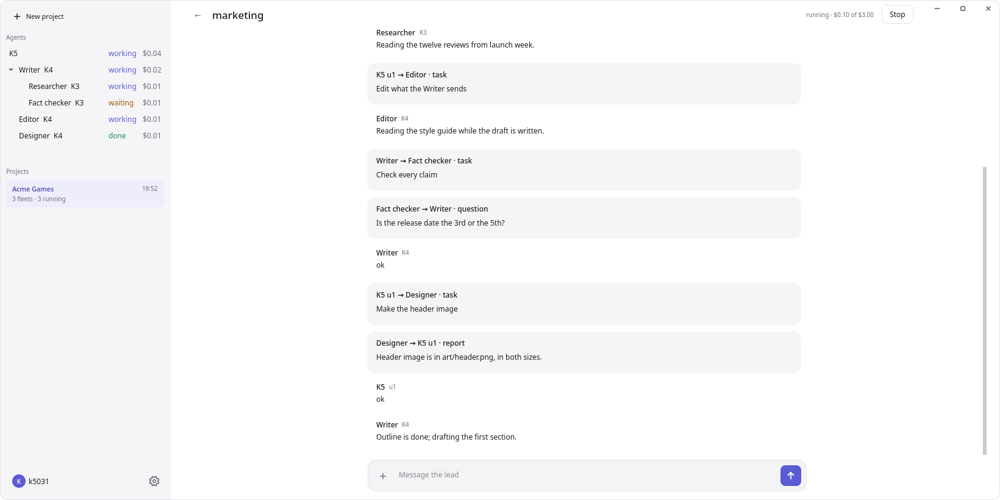

# KFM documentation

KFM (Kadence Fleet Manager) runs teams of Kadence agents. You talk to a team's lead agent;
it hands work to agents below it and reports back. A project holds several teams and a
secretary you ask about all of them.

## Install

KFM needs [Kadence](https://github.com/K5031/Kadence) checked out next to it (`../Kadence`)
and set up with a provider and an API key, and [uv](https://docs.astral.sh/uv/).

```bash
uv tool install --editable .
```

Without installing, `uv run kfm` works from the checkout.

## Run a fleet

In the folder the agents should work in:

```bash
kfm run "Audit the docs in this repository and fix what is out of date" --budget 5
```

| Option | Does |
|---|---|
| `--budget 5` | The most the whole fleet may spend, in US dollars (default: the settings', 10) |
| `--duty` | Standing work that never ends ("be the support team") instead of a task that finishes |
| `--work PATH` | The folder the agents work in (default: the current one) |
| `--project NAME` | The project the fleet belongs to (default: the one whose folder this is, made if there is none) |
| `--name NAME` | What the fleet is called |
| `--detach` | Start it and return: the fleet keeps running, and `kfm watch` follows it |

While it runs, the terminal shows what happens:

```
[K5 u1] working
[Researcher K4 u2] working
[Researcher K4 u2 → K5 u1] report: Three pages are out of date: ...
[K5 u1 → you] report: Fixed the three pages; details in CHANGES.md.
```

- **Type a message** and press Enter to tell the lead something.
- **Approvals:** agents work freely inside the work folder. When one wants to do something
  outside it, KFM asks you (or, with the permission level "auto", only when a check is
  unsure; see Settings): answer `y` or `n`, or `a` (always) to allow it and stop that
  agent asking for the same kind of action, such as running commands outside its sandbox.
- **Questions:** when the lead needs a decision only you can make, it asks and waits for
  your message. Agents below ask their supervisor, not you.
- **Ctrl+C** stops the fleet. A task that finishes ends the run by itself.

## Fleets run in the background

Fleets belong to KFM's service, a program that starts by itself the first time `kfm` or
the window needs it and ends when no fleet runs and nothing is attached to it. The
terminal and the window are two ways of talking to it: a fleet started in one shows up
in the other, and both can follow it at once.

- **Closing the window, or a terminal, does not stop a fleet.** It runs until it is
  stopped, finishes, or reaches its spending limit. `kfm status` shows what runs.
- **A reboot stops every fleet;** `kfm resume` starts one again where it was.
- **After an update** the service still running is the old one, on the code it was
  started with, for as long as a fleet runs or a window is open. The window says so when
  it opens and offers to restart, and each `kfm` command says so in a line. Restart it:
  **Restart KFM** in the menu at the bottom left of the window, or `kfm service restart`.
  Its fleets stop and can be resumed. `kfm service` says since when it runs.

## The command line

Everything the window does has a command. A fleet is named by its name, by
`project/name`, or by the id `kfm status` shows; with none, the newest is meant.

| Command | Does |
|---|---|
| `kfm status [FLEET]` | Projects, their fleets and each fleet's agents: state, spending, task |
| `kfm watch [FLEET]` | Follow a running fleet and talk to its lead; Ctrl+C lets go of it |
| `kfm stop [FLEET]` | Stop a fleet |
| `kfm resume [FLEET] [--budget N]` | Start a stopped fleet again and follow it |
| `kfm say FLEET "text" [--to u2] [--file F]` | A message to the lead, or to one agent, with files. `PROJECT/Secretary` as the fleet reaches a project's secretary |
| `kfm approve FLEET UNIT REQUEST yes\|no\|always` | Answer what an agent asked to do |
| `kfm service [stop\|restart]` | Since when KFM's background service runs; end it, or end it and start another |
| `kfm projects` | List the projects |
| `kfm project new NAME [--work PATH] [--does "text"]`, `rename`, `delete` | Make, rename or delete a project. With `--does`, its secretary proposes its teams. Without `--work` it works in a folder named after it in the projects folder, if one is set, else in the current folder |
| `kfm proposal PROJECT [--start\|--drop]` | The teams its secretary proposed; start them all, or drop the proposal |
| `kfm fleet new PROJECT NAME ["task"] [--model M]`, `rename`, `delete` | Add a fleet: with a task a lead builds it, with none you do |
| `kfm agent add FLEET [--under u1] [--name N] [--task T] [--duty] [--model M]` | An agent under another, or the lead of a fleet with none |
| `kfm agent remove\|rename\|task\|model FLEET UNIT [...]` | Change an agent |
| `kfm settings [--budget N] [--unit-budget N] [--max-agents N] [--model K5=ID] [--model-mode auto\|manual] [--auto-models ID,ID] [--permissions LEVEL]` | Show or change the settings. A change reaches every fleet there is; `--budget` is what a new fleet may spend |
| `kfm serve` | Run the service in this terminal instead of in the background |

## Stop a fleet and start it again

A fleet that was stopped (`kfm stop`, Ctrl+C in `kfm run`, a reboot, or its spending
limit) carries on where it was:

```bash
kfm resume
```

starts the newest fleet again; a name or an id chooses another. Every agent that was at
work gets its conversation, plan and role back, is told that the fleet was down, and
looks at what changed meanwhile. Agents that had finished stay finished.

- **More money:** a fleet that stopped at its limit needs a higher one:
  `kfm resume --budget 20`, or in the window the amount beside **Resume**.
- **What is lost:** commands that were running when the fleet stopped, and a question an
  agent had asked without getting an answer; it asks again.

## The window

```bash
kfm-desktop
```



opens a window on the same service the commands talk to, without a terminal. It needs the `desktop` extra: `uv tool install --editable ".[desktop]"`.

- **A project** is an organisation of fleets: a company, with a fleet for each team
  ("marketing", "dev"). Make one with **New project**: give it a name and choose the
  folder its fleets work in. Your home folder itself is refused, since agents work
  freely inside the folder they are given. To skip choosing, set a **Projects folder**
  in Settings: a new project then gets a folder named after it in there ("Sea Game"
  works in `Sea-Game`), made when you press Create, unless you choose another. If a
  folder of that name is there already with files in it, KFM asks before using it. Projects are listed on the
  left; click one to switch to it. Right-click one to **delete** it: its fleets are
  stopped and their records and logs removed, after you confirm. The folder the agents
  worked in, and everything in it, is kept.
- **Describe the project** in the box under its name and its secretary proposes the
  teams, each with a name and what it is there to do. You can rename them, rewrite what
  they do, leave some out or add your own. Nothing runs until you press **Start**, which
  starts them all, each with the limit shown beside it. Leave the box empty to add the
  fleets yourself: the project opens on its chart, empty, with **Add fleet**.

  

- **The secretary** is the one agent you talk to about the whole project. Click
  **Secretary** at the top of the chart and write to her:
  - *How is it going?* She looks at what each team has reported, asked and been told,
    your own messages to a lead included, and answers.
  - *A small change.* She writes to the lead it concerns.
  - *A change of teams.* She puts a proposal to you, on the same page as the first one,
    and nothing changes until you start it.

  What she writes is her answer: she does not end with a report, as an agent at work
  does. She is not a manager: every lead still answers to you, and you can write to any
  of them yourself. She can read the project's folder and change nothing in it. Between
  your messages she is asleep and costs nothing.

  

- **The chart** is a project's main screen: its fleets side by side, each as the tree of
  who supervises whom, the K5 lead on top. Each agent shows its rank, its state and what
  it has spent. How large a fleet is, is what you see here: its lead hires as the work
  needs.
- **Add fleet**, after the last fleet on the chart: give it a name, write what it does and
  press Enter. A lead starts on that and hires the agents it needs. Under the text you choose **Duty** (standing work that never ends) or
  **Task** (ends when the lead reports it done), a folder of its own if it should not
  work in the project's, and the most the fleet may spend.

  

- **Build a fleet yourself** by leaving "what it does" empty. The fleet appears on the
  chart with no agents and runs nothing. **Add agent** makes its lead; a name, a task
  and a model of its own are all optional. Agents have no name unless given one: a nameless
  agent is shown by its rank ("K4"), and by rank and number ("K4 u2") where agents have
  to be told apart. A lead may name the agents it hires by their role. An agent with no task does not start: it
  takes the first message it gets as its task (its supervisor's, or yours for the lead),
  so you can set up who is on the team and leave the work to be handed out. Right-click an agent to add agents under it.
  **Start**, beside the fleet's name, starts them all, each on the task you gave it; a
  supervisor is told which agents you put under it.

  

- **Right-click an agent** on the chart of any fleet to shape its team. **Add agent**
  puts a new agent under it; its supervisor is told. **Model** changes the model the
  agent runs on, by the model's id; leave it empty for the one its rank has in the
  settings. In a running fleet both happen at once (an agent starts again on its new
  model); in a stopped one they take effect when you start it.
- **Task…** in an agent's right-click menu gives it another task. It keeps its
  conversation, is told, and its supervisor is told. In a stopped fleet the agent works
  on the new task when you start the fleet.
- **Remove…** takes an agent out of the fleet, with every agent under it: they stop,
  and what they kept is deleted. Its supervisor is told, so the work can be picked up.
- **Rename** an agent, a fleet or a project by right-clicking it and choosing
  **Rename…**. Agents are not told: they know each other by number, and a renamed
  agent's reports carry its new name from then on.
- **Delete a fleet** by right-clicking its name on the chart. It is stopped and its
  record and log are removed, after you confirm; the folder it worked in is kept.
- **Several fleets run at once.** Each has its own limit, and is stopped and resumed by
  itself. A team's lead can write to another team's lead, and to the secretary; such a
  message shows in both teams' feeds. A lead's message does not start a team that is stopped; the secretary's does, so
  she can be asked to get a team going again.
- **Open a fleet** by clicking its name on the chart, or an agent to see only what
  concerns it. The arrow at the top left leads back to the chart.

  

- **What waits for you** is at the top of the window, whatever you are looking at: each
  approval an agent asks for, with **Allow**, **Always allow** and **Deny**, and each
  question a lead has put to you, with **Answer**, which opens its fleet. An agent that
  asks stands still until you answer: on the chart and in the agents list it reads
  "asking", and a project in the list on the left says how many wait for you.
- **What an agent is doing now** shows under its feed while it works: the tool it is
  using, the end of what it is thinking, and the message it is writing, which moves into
  the feed once it is whole. While a project's secretary drafts, the same shows under
  "Drafting…". None of it is kept: the feed is the record. An agent's thinking is its
  working out, not what it decided.
- **Agents** of the open fleet are on the left, each under its supervisor, with its
  state and what it has spent. Click one to see only what concerns it; **Show all**
  brings everything back. The secretary's page has no such list: she is one agent.
- **The timeline** shows what the lead says and every report, question and update in
  full, with who sent it to whom. An approval is a card with **Allow**, **Always allow** (that agent no longer asks
  for that kind of action) and **Deny**.
- **Message the lead** in the box at the bottom; Enter sends, Shift+Enter starts a new
  line. A message to a stopped fleet starts it again.
- **An agent's page is a conversation with it.** Choose an agent in the agents list (or
  click it on the chart) to see its task, what its supervisor told it, what it wrote and
  what its own agents sent it, in order. Unlike a chat, others speak in it too, it works
  whether you write or not, and its reports go to its supervisor. With no agent chosen
  the page is the whole fleet's feed.
- **Attach files** to a message with the plus beside the box, by dropping them anywhere
  on the fleet's page, or by pasting them; a copied picture is pasted as a file. They go to the agent the message is for, which reads what it can (pictures, PDFs,
  text and office files); files alone are a message too, except as the first message to an agent
  that has no task yet, which needs words.
- **Message one agent** by choosing it in the agents list first: the box then says whom
  it goes to. The agent is told the message is yours and that it stands over what its
  supervisor said; its supervisor is told what you said. With no agent chosen, or the
  lead chosen, the message goes to the lead.
- **The window has no title bar.** Drag it by the bar at the top, double-click that bar
  to maximize, and resize it at its edges; minimize, maximize and close are at the top
  right.
- **Stop** ends the open fleet's processes; **Resume** carries it on. Closing the window
  leaves fleets running: stop the ones you do not want to keep paying for.
- **Your name, at the bottom left**, opens the app's menu: Settings, Quit and, on Linux
  until it is done, **Add to App Menu**, which puts KFM in your app menu with its own
  icon so it starts without a terminal.
- **The gear** beside it opens **Settings**: the model of each rank, what a fleet and an
  agent may spend, and how many agents a fleet may have. Saving them changes every
  fleet there is, not only new ones: an agent at work starts again on what changed, in
  its own conversation. The one exception is **Per fleet**, which is what a new fleet
  starts with; a fleet's own limit is changed beside its Resume button.

What happens in a fleet is also kept as `log.jsonl` in the fleet's folder, one line per
event, whichever way the fleet was run.

## How a fleet works

- **Ranks.** The lead has the top rank (K5 by default). An agent can hand work only to
  new agents one rank below it, so K1 agents do their work themselves. The fleet uses only
  as many levels as the lead and its agents decide the work needs.
- **Each agent is a separate Kadence** with its own conversation and memory. It sees
  nothing of the others; it knows only its task and what is reported to it.
- **Reports go up.** When an agent finishes, asks a question or fails, its supervisor gets
  a message and decides what to do next: answer, give the task again, or hand it to
  another agent.
- **Spending.** Each agent has its own limit, and the fleet has one for everyone. When the
  fleet's limit is reached, the fleet stops.

## Settings

`~/.kfm/fleet.toml`, all optional. The window's Settings write the models and the limits
into it and leave the rest as it is:

```toml
top_rank = 5
max_units = 12            # agents in one fleet
budget_usd = 10.0         # the whole fleet
unit_budget_usd = 2.0     # one agent
permissions = "allow_workspace"
projects_folder = "~/Projects"   # a new project gets a folder named after it in here

[harness_options]         # for Kadence, the agent program the units run
config = "~/.kadence/config.toml"   # the provider, key and options every agent uses

[models]                  # a model per rank; "default" for the rest
K5 = "claude-opus-5-5"
default = "claude-sonnet-5-5"
secretary = "claude-sonnet-5-5"   # a project's secretary; without it, the top rank's

[teams]                   # a team's model wins over its rank's
marketing = "claude-sonnet-5-5"
```

Without `[models]`, every agent uses the model in your Kadence configuration. In the
window's Settings each field has a list of the models your provider offers; one that is
not listed can be typed.

Models are chosen in one of two ways (**Models** in Settings, `model_mode` in the file):

- **Manual**, the default: you set a model for each rank. **Default** is the model of
  every rank you set none for, and an empty rank says which that is. An agent cannot
  choose a model.
- **Auto**: whoever starts an agent names its model. You tick the models that may be
  used under **Allowed** and set the secretary's, since nobody starts her; the ranks are
  not shown. A lead names the model of each agent it hires and is told the models'
  prices; the secretary names the model of each team's lead in her proposal, which you
  can change before starting; and you pick the lead's model when you add a fleet
  yourself (`--model` in the terminal).

```toml
model_mode = "auto"
auto_models = ["claude-haiku-5-5", "claude-sonnet-5-5", "claude-opus-5-5"]

[models]
secretary = "claude-sonnet-5-5"
```

### What agents do without asking

`permissions`, **Permission** in the window's Settings, is the level every agent has,
in fleets that are there already too. A project's secretary only ever reads.

| Level | Agents |
|---|---|
| `auto` (Auto) | work freely in their folder; anything outside it is first checked by a small model against the task. What is clearly fine runs; the rest asks you, with the reason |
| `allow_workspace` (Work folder, the default) | work freely in their folder and ask before anything outside it |
| `allow_read_only` (Read only) | read freely and ask before any change |
| `ask` (Ask first) | ask before every action |
| `deny` (No tools) | run no tools |

`auto` saves you most questions and is not a guarantee: the check is a model's judgment,
and what it allows runs with your rights. Deleting or overwriting what the task did not
name, sending data anywhere, publishing or pushing, spending money, and changes to the
system are what it is told to ask about, and anything that touches keys, passwords or
Kadence's own data always asks you. In a fleet the task it judges by is the one the
agent's supervisor gave. A project's secretary is read-only whatever the level.

## Another agent program

Every agent of a fleet is a Kadence unless the settings name another program:

```toml
harness = "my_package.my_harness:factory"   # or the name it is installed under

[harness_options]
# whatever that program needs
```

Such a program has to be written for KFM: it works by itself on an instruction, reports,
asks its supervisor when blocked, and uses the fleet's tools. What exactly it must do is
in `src/kfm/api.py`, and `tests/fakeharness.py` is a small complete example.

## Not there yet

- The service uses a Unix socket: Linux and macOS, not Windows.
- The secretary proposes new teams; ending a team or rewriting what one does is yours
  to do, or hers to ask its lead.
- Agents share one folder, and nothing stops two from editing the same file.
